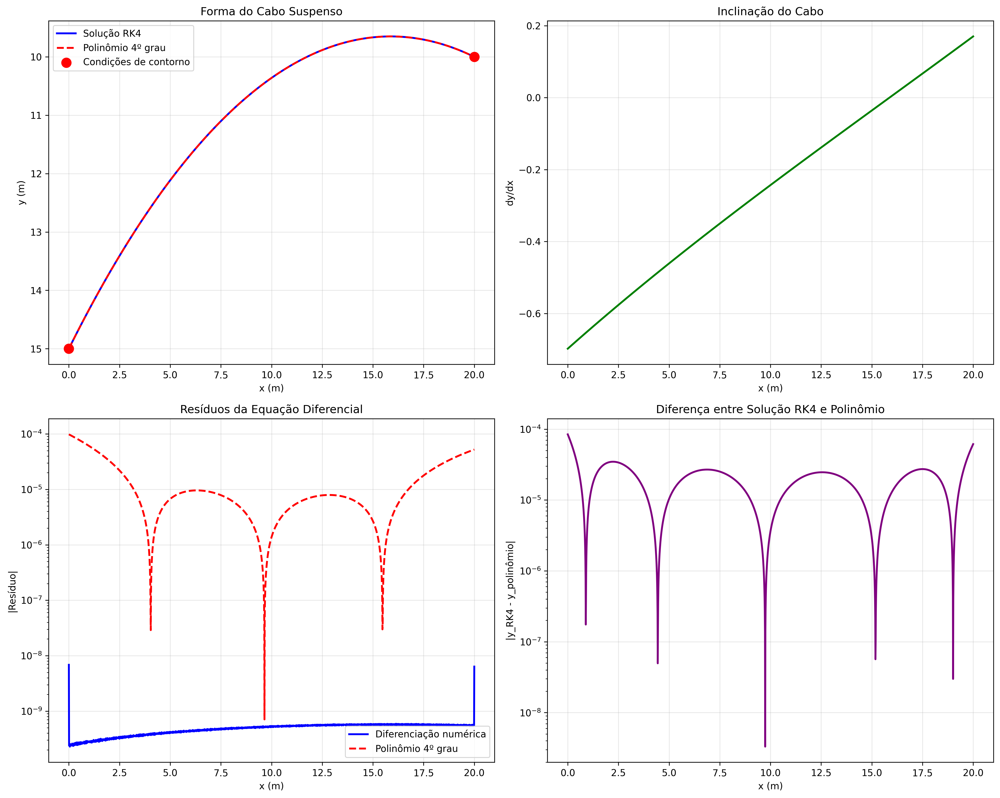

# Cabo Suspenso — Solução Numérica da Catenária


Implementação computacional de um **problema de valor de contorno (PVC)** aplicado à análise de um cabo flexível suspenso entre dois pontos.

O projeto utiliza **Python e métodos numéricos** para determinar a curva da catenária, verificar a precisão da solução, comparar diferentes aproximações matemáticas e visualizar os resultados.

## Visualização dos resultados



O projeto gera gráficos que representam:

- A forma do cabo suspenso e seu ponto mais baixo.
- A inclinação do cabo ao longo do intervalo.
- Os resíduos da equação diferencial.
- A diferença entre a solução numérica e o ajuste polinomial.

## Objetivos

O objetivo principal é resolver numericamente a equação diferencial que descreve o equilíbrio de um cabo flexível submetido ao próprio peso.

Os objetivos específicos incluem:

- Resolver o problema usando o método do tiro.
- Implementar Runge-Kutta de quarta ordem (RK4).
- Utilizar o método da secante para determinar a inclinação inicial.
- Validar a solução por diferenciação numérica.
- Realizar uma regressão polinomial de quarto grau.
- Comparar os resultados com a expressão analítica da catenária.
- Calcular propriedades geométricas e físicas do cabo.
- Gerar gráficos, tabelas e relatórios automaticamente.

## Modelagem matemática

O comportamento do cabo é descrito pela equação diferencial:

$$
\frac{d^2y}{dx^2} =
C\sqrt{1+\left(\frac{dy}{dx}\right)^2}
$$

Onde:

- `y(x)` representa a altura do cabo em função da posição horizontal.
- `C` é uma constante relacionada ao peso por unidade de comprimento e à componente horizontal da tensão.
- `dy/dx` representa a inclinação do cabo.
- `d²y/dx²` representa a segunda derivada da curva.

### Parâmetros do problema

| Parâmetro | Valor |
| --- | --- |
| Posição inicial | x = 0 m |
| Altura inicial | y(0) = 15 m |
| Posição final | x = 20 m |
| Altura final | y(20) = 10 m |
| Constante C | 0,041 m⁻¹ |
| Passo de integração | h = 0,01 |
| Tolerância | 10⁻⁵ |

O problema consiste em encontrar uma função `y(x)` que satisfaça simultaneamente a equação diferencial e as condições de contorno.

## Métodos numéricos implementados

### 1. Método do Tiro (Shooting Method)

O método do tiro transforma o problema de valor de contorno em um problema de valor inicial.

A inclinação inicial do cabo é inicialmente desconhecida. O algoritmo realiza estimativas dessa inclinação e integra a equação diferencial até o ponto final.

A estimativa é corrigida até que o valor calculado para `y(20)` esteja suficientemente próximo de 10 metros.

### 2. Runge-Kutta de quarta ordem (RK4)

O método RK4 é utilizado para integrar numericamente o sistema de equações diferenciais de primeira ordem:

$$
y_1'=y_2
$$

$$
y_2'=C\sqrt{1+y_2^2}
$$

O método combina quatro avaliações da função em cada passo de integração, proporcionando precisão de quarta ordem global sob condições usuais de regularidade.

### 3. Método da Secante

O método da secante ajusta a inclinação inicial utilizada pelo método do tiro.

A função de erro é definida por:

$$
F(z)=y(x_f;z)-y_f
$$

O algoritmo procura um valor de `z` que satisfaça:

$$
|F(z)| \leq 10^{-5}
$$

A implementação utiliza estimativas iniciais `z0 = -1,0` e `z1 = -0,5`, com limite de 100 iterações.

### 4. Diferenciação numérica

Após determinar os valores de `x` e `y(x)`, o projeto calcula aproximações das derivadas primeira e segunda.

São utilizadas fórmulas de diferenças finitas de segunda ordem.

A solução é verificada por meio do resíduo:

$$
R(x)=\left|y''(x)-C\sqrt{1+(y'(x))^2}\right|
$$

O programa calcula os resíduos máximo, médio e RMS para avaliar a consistência numérica com a equação diferencial.

### 5. Regressão polinomial de quarto grau

Os pontos da solução numérica são utilizados para ajustar um polinômio:

$$
P(x)=c_4x^4+c_3x^3+c_2x^2+c_1x+c_0
$$

O ajuste é realizado com `numpy.polyfit()`.

Além de calcular o coeficiente de determinação R², o programa deriva o polinômio e verifica seu resíduo em relação à equação diferencial original.

### 6. Comparação com a solução analítica

A solução numérica é comparada à expressão da catenária:

$$
y(x)=a\cosh\left(\frac{x-b}{a}\right)+d
$$

Onde:

$$
a=\frac{1}{C}
$$

Os parâmetros `b` e `d` são determinados a partir da inclinação inicial obtida numericamente e da condição de contorno inicial.

O programa calcula os erros máximo e RMS entre as soluções.

## Tecnologias utilizadas

| Tecnologia | Finalidade |
| --- | --- |
| Python | Implementação dos algoritmos |
| NumPy | Operações numéricas, vetores e regressão |
| Matplotlib | Visualização gráfica |
| Pandas | Organização e exportação dos dados CSV |
| pathlib | Manipulação de caminhos de arquivos |

## Como executar

### Pré-requisitos

- Python 3 instalado.
- pip disponível.
- Git para clonar o repositório.

### 1. Clonar o repositório

```bash
git clone https://github.com/fhenrique77/cabo-suspenso-catenaria.git
cd cabo-suspenso-catenaria
```

### 2. Criar um ambiente virtual (recomendado)

No Windows:

```powershell
python -m venv .venv
.venv\Scripts\activate
```

No Linux/macOS:

```bash
python3 -m venv .venv
source .venv/bin/activate
```

### 3. Instalar as dependências

```bash
pip install -r requirements.txt
```

As dependências declaradas são:

```text
numpy>=1.21.0
matplotlib>=3.5.0
pandas>=1.3.0
```

### 4. Executar o programa

```bash
python src/solucao_cabo.py
```

Em alguns ambientes Linux/macOS, utilize `python3` no lugar de `python`.

O script executa automaticamente a resolução do problema, as verificações numéricas e a geração dos resultados.

## Resultados numéricos

O repositório contém resultados de execuções anteriores, incluindo arquivos CSV e relatórios.

### Amostra de valores calculados

Valores registrados no arquivo `results/dados_cabo.csv`:

| x (m) | y(x) (m) |
| --- | --- |
| 0 | 15,00000 |
| 5 | 12,11403 |
| 10 | 10,36056 |
| 15 | 9,66565 |
| 20 | 10,00000 |

### Propriedades do cabo

Para os parâmetros padrão, os resultados registrados e a análise da catenária indicam aproximadamente:

| Propriedade | Valor |
| --- | --- |
| Comprimento do cabo | 21,165 m |
| Posição horizontal do ponto mais baixo | 15,87 m |
| Altura mínima | 9,650 m |
| Diferença vertical entre o apoio inicial e o ponto mínimo | 5,350 m |
| Parâmetro da catenária (1/C) | 24,390 m |

O comprimento é obtido por aproximação numérica do comprimento de arco. As propriedades dependem dos parâmetros escolhidos e podem variar em outras simulações.

O código também calcula grandezas normalizadas associadas à tensão e a curvatura do cabo. Esses valores não devem ser interpretados como forças em newtons sem informações adicionais sobre a carga por unidade de comprimento.

## Arquivos gerados

Ao executar o script a partir da raiz do repositório, são criados os seguintes tipos de arquivos:

| Arquivo | Conteúdo |
| --- | --- |
| `resultados_cabo_*.png` | Gráficos da análise |
| `dados_cabo_*.csv` | Pontos numéricos, derivadas e resíduos |
| `relatorio_cabo_*.txt` | Parâmetros, propriedades e informações da execução |

O sufixo `*` representa a data e a hora de geração.

**Observação:** a versão atual do script salva os novos arquivos no diretório de execução, geralmente a raiz do projeto. A pasta `results/` contém resultados previamente organizados no repositório.

## Estrutura do projeto

```text
cabo-suspenso-catenaria/
├── src/
│   └── solucao_cabo.py
├── docs/
│   ├── trabalho.md
│   ├── trabalho_markdown.md
│   └── relatorio_cabo_final.txt
├── results/
│   ├── dados_cabo.csv
│   ├── dados_cabo_*.csv
│   └── resultados_cabo_*.png
├── solucao_cabo.py
├── trabalho.md
├── Trabalho.pdf
├── requirements.txt
├── README.md
├── LICENSE
├── .gitignore
├── PROJETO_SUMMARY.md
└── GITHUB_INSTRUCTIONS.md
```

O código principal está em `src/solucao_cabo.py`. O repositório também mantém uma cópia do script na raiz.

## Organização do código

A classe `CaboProblem` concentra as etapas de resolução:

| Método | Responsabilidade |
| --- | --- |
| `sistema_edo()` | Representação do sistema diferencial |
| `runge_kutta_4()` | Integração numérica |
| `funcao_erro()` | Cálculo do erro de contorno |
| `resolver_metodo_tiro()` | Busca da inclinação inicial |
| `diferenciacao_numerica()` | Aproximação das derivadas |
| `verificar_equacao_diferencial()` | Avaliação dos resíduos |
| `regressao_polinomial()` | Ajuste de quarto grau |
| `solucao_analitica_aproximada()` | Comparação analítica |
| `calcular_propriedades_cabo()` | Cálculo das propriedades |
| `plotar_resultados()` | Geração de gráficos |
| `exportar_dados()` | Exportação CSV e relatório |

A função `main()` coordena a execução completa.

## Documentação adicional

- [Enunciado do problema](docs/trabalho_markdown.md)
- [Documentação técnica](docs/trabalho.md)
- [Relatório da análise](docs/relatorio_cabo_final.txt)
- [Resultados numéricos em CSV](results/dados_cabo.csv)

## Possíveis melhorias

- Implementar testes unitários para os métodos numéricos.
- Permitir configuração dos parâmetros pela linha de comando.
- Comparar o método do tiro com outros métodos de resolução.
- Criar uma interface interativa para modificar os parâmetros.
- Organizar automaticamente os arquivos gerados em `results/`.
- Automatizar verificações numéricas por meio de integração contínua.

## Licença

Este projeto está distribuído sob a [Licença MIT](LICENSE).

## Autor

**Felipe Henrique**

Estudante de Engenharia de Software na Universidade de Brasília (UnB).

GitHub: [@fhenrique77](https://github.com/fhenrique77)
